

<!-- BANNER - terminal profile.sh --live. Generated by scripts/banner/generate.py. -->
<picture>
  <source media="(prefers-color-scheme: dark)"  srcset="assets/banner-dark.v1.svg">
  <source media="(prefers-color-scheme: light)" srcset="assets/banner-light.v1.svg">
  
</picture>

 

<!-- NAME / TAGLINE - animated typing -->

 

<!-- SOCIALS -->
&nbsp;&nbsp;

 

---

## This is me :)

Hi, I'm **Riccardo Giorgio Ponte**, a builder and developer based in **Milano, Italia** 🇮🇹.
I love turning complex workflows into fast, practical software — from multi-agent AI pipelines to browser extensions, developer tools, and native mobile apps.

- 🤖 **AI & Multi-Agent Systems**: Built **OmniPitch** (multi-agent live match broadcast with real-time grounding verification) and **TRIDENT** (multi-agent AI red-teaming accelerator mapped to OWASP LLM Top 10 & MITRE ATLAS) during Microsoft hackathons.
- 🧩 **Automation & DevTools**: Created **Flowpilot** (VS Code extension combining browser action recording with GitHub Copilot Agent + Playwright MCP for automated QA reports) and **MarkItDown Desktop** (offline multilingual OCR + document-to-Markdown GUI).
- 🌐 **Web, Extensions & PWAs**: Shipped **ASIN Hunter** (Chrome/Edge extension on the Chrome Web Store), **WARFIT** (Workout & Food Tracker PWA), and interactive client-side tools like **Image Studio**.
- 📱 **Android Systems (Kotlin)**: Engineered rootless native utilities like **App Uninstaller Pro** (embedded local ADB engine over TLS 1.3) and **Connector Firewall** (per-app Wi-Fi/mobile data control).
- 🌱 **Always shipping**: Experimenting at the intersection of **AI agents, clean UX, and everyday automation**.

 

## my stack

---

## featured projects

<table>
<tr>
<td width="50%" align="center" valign="middle">
  <a href="https://github.com/riccardoponte/OmniPitch">
    <picture>
      <source media="(prefers-color-scheme: dark)"  srcset="assets/card-OmniPitch-dark.svg">
      <source media="(prefers-color-scheme: light)" srcset="assets/card-OmniPitch-light.svg">
      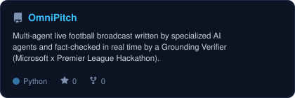
    </picture>
  </a>
</td>
<td width="50%" align="center" valign="middle">
  <a href="https://github.com/riccardoponte/trident-microsoft-global-intern-hackathon">
    <picture>
      <source media="(prefers-color-scheme: dark)"  srcset="assets/card-trident-microsoft-global-intern-hackathon-dark.svg">
      <source media="(prefers-color-scheme: light)" srcset="assets/card-trident-microsoft-global-intern-hackathon-light.svg">
      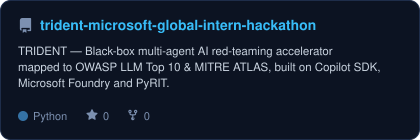
    </picture>
  </a>
</td>
</tr>
<tr>
<td width="50%" align="center" valign="middle">
  <a href="https://github.com/riccardoponte/Flowpilot-VS-Code">
    <picture>
      <source media="(prefers-color-scheme: dark)"  srcset="assets/card-Flowpilot-VS-Code-dark.svg">
      <source media="(prefers-color-scheme: light)" srcset="assets/card-Flowpilot-VS-Code-light.svg">
      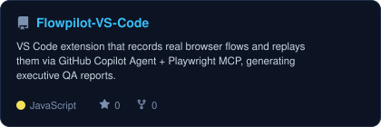
    </picture>
  </a>
</td>
<td width="50%" align="center" valign="middle">
  <a href="https://github.com/riccardoponte/ASIN-Hunter">
    <picture>
      <source media="(prefers-color-scheme: dark)"  srcset="assets/card-ASIN-Hunter-dark.svg">
      <source media="(prefers-color-scheme: light)" srcset="assets/card-ASIN-Hunter-light.svg">
      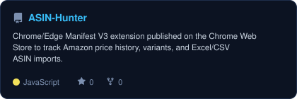
    </picture>
  </a>
</td>
</tr>
<tr>
<td width="50%" align="center" valign="middle">
  <a href="https://github.com/riccardoponte/Android-System-App-Uninstaller">
    <picture>
      <source media="(prefers-color-scheme: dark)"  srcset="assets/card-Android-System-App-Uninstaller-dark.svg">
      <source media="(prefers-color-scheme: light)" srcset="assets/card-Android-System-App-Uninstaller-light.svg">
      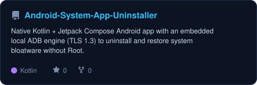
    </picture>
  </a>
</td>
<td width="50%" align="center" valign="middle">
  <a href="https://github.com/riccardoponte/MarkItDown-Converter">
    <picture>
      <source media="(prefers-color-scheme: dark)"  srcset="assets/card-MarkItDown-Converter-dark.svg">
      <source media="(prefers-color-scheme: light)" srcset="assets/card-MarkItDown-Converter-light.svg">
      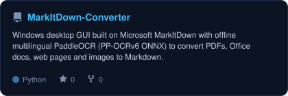
    </picture>
  </a>
</td>
</tr>
</table>

---

## signals

<table>
<tr>
<td width="50%" align="center" valign="middle">

<picture>
  <source media="(prefers-color-scheme: dark)"  srcset="assets/radar-dark.svg">
  <source media="(prefers-color-scheme: light)" srcset="assets/radar-light.svg">
  
</picture>

</td>
<td width="50%" align="center" valign="middle">

<picture>
  <source media="(prefers-color-scheme: dark)"  srcset="assets/radar-langs-dark.svg">
  <source media="(prefers-color-scheme: light)" srcset="assets/radar-langs-light.svg">
  
</picture>

</td>
</tr>
</table>

---

## Numbers matter? ohhh yes.

<picture>
  <source media="(prefers-color-scheme: dark)"  srcset="assets/card-stats-dark.svg">
  <source media="(prefers-color-scheme: light)" srcset="assets/card-stats-light.svg">
  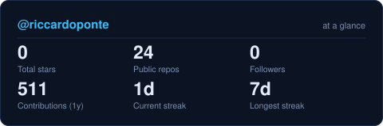
</picture>

  

<picture>
  <source media="(prefers-color-scheme: dark)"  srcset="assets/metrics-languages-dark.svg">
  <source media="(prefers-color-scheme: light)" srcset="assets/metrics-languages-light.svg">
  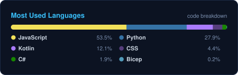
</picture>

---

`Built in Milano · @riccardoponte`

